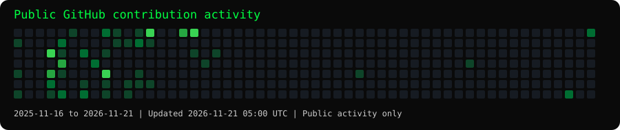

<div align="center">

<!-- Animated terminal banner -->


```
╔══════════════════════════════════════════════════════════════╗
║  > whoami                                                    ║
║  Jesse Amiandah - Full Stack Dev, QA Engineer, AI Annotator   ║
║  Location: Mombasa, Kenya  //  Status: Open to Remote       ║
║  Stack: Python · JS/TS · Django · Next.js · PostgreSQL      ║
╚══════════════════════════════════════════════════════════════╝
```

</div>

---

## `> cat about.txt`

```python
class Jesse:
    role       = ["Full Stack Developer", "QA Engineer ", "AI Data Annotator"]
    location   = "Mombasa, Kenya 🌍 (Open to Remote)"
    education  = "B.Sc. Information Technology - Technical University of Mombasa"
    experience = "2+ years self-directed · AIRS platform · 5 crowd-testing platforms"
    currently  = "Building secure web apps · Exploring RAG and agent workflows"
    contact    = "jesse.amianda@chrisdevcode.com"
    fun_facts  = [
        "Debugged production at community radio (SwahilipotFM) - live audience pressure ",
        "Built Web3 wallet sync for a real regenerative stewardship platform ",
        "Hackathon survivor: Kachiri and Code · Afrikas Talking · Green World Campaign ",
        "Tested apps on 5 crowd-testing platforms simultaneously - multitasking is my API",
    ]
```

---

## `> cat recent-work.md`

Building practical web products and AI support workflows, with security, accessibility and testing as priorities.

- Completed Udacity's **Future AWS Agent Engineer Nanodegree** on **29 October 2026**.
- Applied agent orchestration and retrieval-augmented generation (RAG) concepts in customer-support projects, then built a local demo that can run without cloud credits.
- Currently developing **[Twana Baby Shop](https://github.com/iRobot90/twanababyshop)**, **[Petoria](https://github.com/iRobot90/Petoria)**, **[nativeFly](https://github.com/iRobot90/nativeFly)** and **[PayGram](https://github.com/iRobot90/PayGram)**. These are works in progress, with functionality and security first.

## `> cat certifications.md`

| Learning milestone | Issuer | Verification |
|---|---|---|
| Future AWS Agent Engineer Nanodegree | Udacity · October 2026 | [Certificate](https://www.udacity.com/certificate/e/be3bef58-900d-11f1-a402-bbffe1372440) |
| Claude Code in Action | Anthropic · March 2026 | [LinkedIn credentials](https://www.linkedin.com/in/jesse-amiandah/details/certifications/) |
| Foundations of UX Design & UX Design Process | Google · 2024 | [LinkedIn credentials](https://www.linkedin.com/in/jesse-amiandah/details/certifications/) |
| Bug Finding, Web Hacking & Test Campaign Tools | TRYBER / UNGUESS · 2024 | [LinkedIn credentials](https://www.linkedin.com/in/jesse-amiandah/details/certifications/) |

The AWS-focused Nanodegree is a **Udacity program-completion credential**, not an AWS certification exam credential. Coursework covered Amazon Bedrock, RAG, multi-agent orchestration, AgentCore, IAM, CloudFormation, CloudWatch and X-Ray.

## `> cat experience.md`

- **Magic:** client operations, AI workflow testing and turning client feedback into actionable product follow-ups.
- **Freelance QA:** functional, exploratory and usability testing across crowd-testing platforms, with reproducible bug reports and API checks.
- **Green World Campaign Kenya:** digital research and field-data quality work, alongside contributions to the AIRS platform.
- **Swahilipot Hub:** community web projects and digital-literacy facilitation.

More detail: [LinkedIn](https://www.linkedin.com/in/jesse-amiandah/) · [Portfolio](https://jesseamiandah-dev.vercel.app)

## `> ls ai-projects/`

| Project | What you can explore |
|---|---|
| [Support Lab](https://github.com/iRobot90/support-lab) | Runnable Python/SQLite support-chat demo. The default mode is rules-based; optional local-model and AWS integrations are separate from the offline demo. |
| [NovaMart Support Case Study](https://github.com/iRobot90/novamart-support-case-study) | Multi-agent support design covering inventory, policy retrieval, refunds and communication. A documented case study, not a hosted production service. |
| [Customer Support Flow Case Study](https://github.com/iRobot90/customer-support-flow-case-study) | FAQ, bug-report collection and human-handoff flows, with a scripted offline demo. |

## `> cat writing.md`

Short, practical notes from the testing side of building software:

- [QA Testing Randoms: Random Dude](https://www.linkedin.com/pulse/qa-testing-randoms-random-dude-jesse-amiandah-jteof)
- [QA Testing Randoms: Chapter 1, Module 2](https://www.linkedin.com/pulse/qa-testing-randoms-chapter-1-part-module-2-jesse-amiandah-3igqf)
- [QA Randoms: 5 Sites Where You Learn to Test and Get Paid](https://medium.com/@jaytheQA/qa-randoms-chapter-1-the-last-module-5-sites-where-you-learn-to-test-and-get-paid-4307b6a00439)

---

## `> ls skills/`

**Languages**


**Frontend**


**Backend**


**Databases**


**Testing & QA**


**Infrastructure & DevOps**


---

## `> git log --oneline --projects`

| Project | Stack | Description |
|---|---|---|
|  **[AIRS](https://github.com/Green-World-Campaign-Kenya/airs)** |    | Regenerative stewardship incentive platform with crypto wallet sync and stablecoin distribution |
|  **[Team Task Manager](https://github.com/iRobot90/team-task-management-system)** |   | Multi-role task management with RBAC, scoped API access and full task lifecycle tracking |
|  **[SwahilipotFM](https://github.com/amiandah/swahilipot-fm)** |   | Public-facing platform for a live community radio station serving Mombasa |
|  **[TwanaBabyShop](https://github.com/iRobot90/twanababyshop)** |   | E-commerce site for baby products built with React |
|  **[Code and Bugs Showcase](https://github.com/iRobot90/code-and-bugs-showcase)** |  | Dev showcase project demonstrating full stack capabilities and QA practices |
|  **[HACKERTHON](https://github.com/iRobot90/HACKERTHON)** |  | Hackathon project built under time-constrained sprint conditions |

---

## `> htop --github-stats`

<div align="center">

<!-- Real-time stats - refresh on every profile visit -->


<!-- Real-time streak -->
<br/>


</div>

---

## `> cat top_repos.txt`

<div align="center">

[](https://github.com/Green-World-Campaign-Kenya/airs)
[](https://github.com/iRobot90/team-task-management-system)
[](https://github.com/iRobot90/code-and-bugs-showcase)
[](https://github.com/iRobot90/twanababyshop)
[](https://github.com/amiandah/swahilipot-fm)
[](https://github.com/iRobot90/HACKERTHON)

</div>

---

## `> tail -f activity.log`

<div align="center">

<!-- Updated daily from public GitHub contribution levels by snake.yml. -->
[](https://github.com/iRobot90?tab=overview)

</div>

---

## `> snake --eat-contributions`

<div align="center">

<!-- Generated daily by GitHub Actions workflow - see .github/workflows/snake.yml -->
<picture>
  <source media="(prefers-color-scheme: dark)" srcset="https://raw.githubusercontent.com/iRobot90/iRobot90/output/github-contribution-grid-snake-dark.svg" />
  <source media="(prefers-color-scheme: light)" srcset="https://raw.githubusercontent.com/iRobot90/iRobot90/output/github-contribution-grid-snake.svg" />
  
</picture>

</div>

---

## `> fortune --dev`

<div align="center">

<!-- Rotates a new programming quote every day -->


</div>

---

## `> ping jesse --social`

<div align="center">

[](https://jesseamiandah-dev.vercel.app)
[](https://linkedin.com/in/jesse-amiandah)
[](mailto:jesse.amianda@chrisdevcode.com)
[](https://github.com/iRobot90)

</div>

---

<div align="center">

```
// always learning · always shipping · never idle
```


</div>
